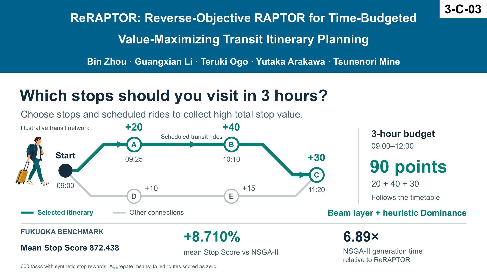
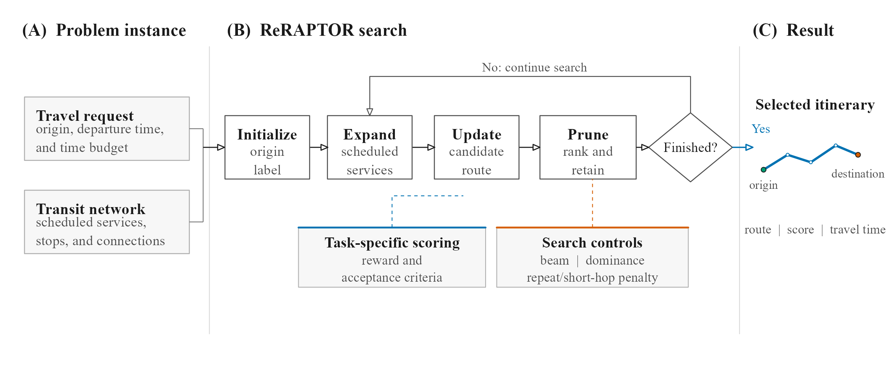

<h1 align="center">ReRAPTOR</h1>

<p align="center">
  <strong>Reverse-Objective RAPTOR for Time-Budgeted Value-Maximizing Transit Itinerary Planning</strong>
</p>

<p align="center">
  <a href="paper/REPRODUCTION_TUTORIAL.md">Reproduction tutorial</a> &middot;
  <a href="paper/SUPPLEMENTARY_MATERIALS.md">Supplementary materials</a> &middot;
  <a href="paper/results/README.md">Results</a> &middot;
  <a href="paper/REPRODUCIBILITY.md">Reproducibility record</a>
</p>

<p align="center">
  <a href="assets/reraptor-overview.png">
    
  </a>
</p>

ReRAPTOR chooses stops and scheduled transit rides to maximize collected stop
value within a time budget. This paper companion provides the planner, ten
comparison methods, four experiment pipelines, and the released results used
in the manuscript.

## Start here

| I want to | Go to |
| --- | --- |
| Install the code and reproduce the experiments | [Step-by-step tutorial](paper/REPRODUCTION_TUTORIAL.md) |
| Check reported results without private inputs | [Result verification](paper/REPRODUCTION_TUTORIAL.md#2-clone-and-create-an-isolated-python-environment) |
| Read supplementary tables and figures | [Supplementary materials](paper/SUPPLEMENTARY_MATERIALS.md) |
| Prepare authorized inputs for a solver rerun | [Data layout and schemas](apps/api/data/README.md) |

### Quick check (no private inputs required)

Use Python **3.12** from the repository root. Create and activate a virtual
environment first; the [tutorial](paper/REPRODUCTION_TUTORIAL.md#2-clone-and-create-an-isolated-python-environment)
has Windows, Linux, and macOS instructions.

```sh
python -m pip install -r paper/requirements.txt
python -m paper.experiments.check_reproduction
python -m pytest -q paper/experiments/tests
python -m paper.experiments.verify_manuscript_claims
```

These commands check installation, scoring/protocol tests, and released result
claims. An end-to-end solver rerun requires the six authorized private inputs.

## How it works

<p align="center">
  <a href="paper/figures/method/ours_framework_flow.pdf">
    
  </a>
</p>

Scheduled services define feasible expansions. Task-specific scoring evaluates
candidate routes, while a beam layer, heuristic dominance, and optional penalties
control the search. The output is a selected itinerary with its score and travel
time. Click the workflow to open the vector PDF.

## Experiments

| Experiment | Focus | Instructions |
| --- | --- | --- |
| **Exp1** | Ten algorithms / 22,800 records | [Algorithm comparison](paper/experiments/exp1_algorithm_comparison/README.md) |
| **Exp2** | Eight configurations / 4,800 records | [Pruning ablation](paper/experiments/exp2_ablation_study/README.md) |
| **Exp3** | 18 OAT configurations and four interaction corners / 11,088 runs | [Parameter sensitivity](paper/experiments/exp3_parameter_sensitivity/README.md) |
| **Exp4** | Representative successes, tradeoffs, and a counterexample | [Route case studies](paper/experiments/exp4_route_visualization/README.md) |

The overview's benchmark figures summarize 600 tasks with synthetic stop rewards;
failed routes receive zero score. See the [released results](paper/results/README.md)
and [claim-to-artifact map](paper/REPRODUCIBILITY.md) for the underlying evidence.

## Data availability

**Private transit inputs and credentials are not distributed.** The public
results support auditing and statistical analysis; full solver reproduction
requires authorized copies of all six planner inputs. Follow the
[input guide](apps/api/data/README.md) and run the exact-snapshot check before
rerunning the solvers.

The frozen timetable is for **24 December 2025**. Its checksum and inventory are
recorded in [the provenance record](paper/results/timetable_provenance.json).
The submitted article, editorial correspondence, and unrelated application
frontend are outside this companion repository.

<details>
<summary><strong>Repository guide</strong></summary>

| Location | Contents |
| --- | --- |
| [apps/api/services](apps/api/services/) | Planner and timetable services |
| [paper/experiments](paper/experiments/) | Algorithms, experiment runners, analyses, and tests |
| [paper/experiments/r_visualization](paper/experiments/r_visualization/README.md) | R figure rendering pipeline |
| [paper/results](paper/results/README.md) | Frozen canonical outputs and derived tables |
| [paper/figures](paper/figures/) | Manuscript and supplementary figures |
| [paper/document](paper/document/) | Supplementary document source and PDF |

To rebuild the supplement, run `latexmk -pdf supplementary_materials.tex` from
`paper/document/` with a TeX distribution installed. Figure rendering and full
experiment commands are documented in the reproduction tutorial.

</details>

<sub>Overview visual: exported from the authors' 3-C-03 presentation. Workflow: the paper's ReRAPTOR method figure. Code license: <a href="LICENSE">MIT</a>.</sub>
